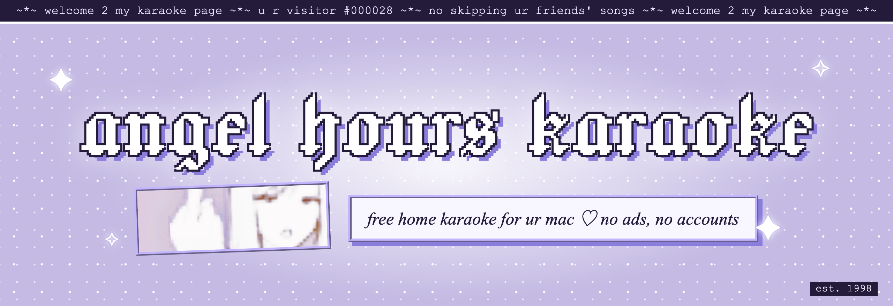
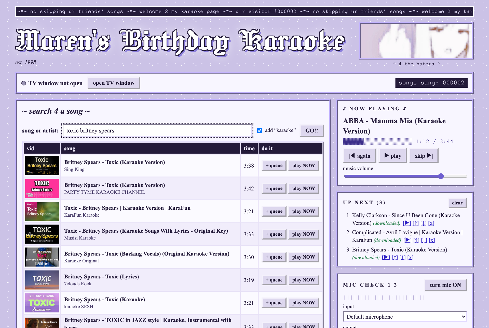
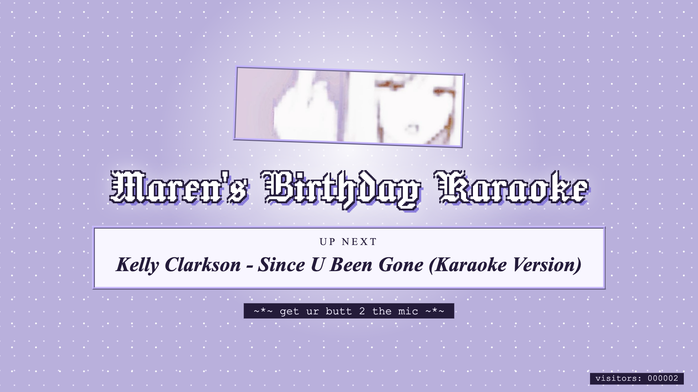

<p align="center">
  
</p>

<p align="center">
  
  
  
  
  <a href="LICENSE"></a>
  
</p>

<p align="center">
  <i>~*~ welcome 2 my karaoke page ~*~</i>
</p>

**angel hours karaoke** is free home karaoke for your Mac, in a browser. Search any song on YouTube, queue it up,
and play it full screen on your TV while your mic plays through the speakers with reverb and echo. Videos that
won't embed download automatically. No API keys, no accounts, no ads. Styled like a 2003 personal homepage.

<p align="center">
  
  <br>
  <sub><i>the control panel lives on your laptop</i></sub>
</p>

<p align="center">
  
  <br>
  <sub><i>the TV window goes full screen on the big screen</i></sub>
</p>

<p align="center">· ˚ ✧ ˚ · ♡ · ˚ ✧ ˚ ·</p>

## ✧ what it does

- ✦ **Search all of YouTube** for karaoke versions, with no API key, through [yt-dlp](https://github.com/yt-dlp/yt-dlp).
- ✦ **Queue songs** and reorder them. When one ends, the next starts by itself.
- ✦ **Play anything.** Big karaoke channels (Sing King, KaraFun, karaoke SESH, …) block YouTube's embedded player,
  so those songs download in 720p in the background as soon as you queue them.
- ✦ **Your mic through the speakers**, with volume, reverb (cathedral) and echo echo echo.
- ✦ **A TV window** with "up next" cards between songs and a banner with the song title.
- ✦ **A fake visitor counter** ("u r visitor #000012") that actually counts songs sung.
- ✦ **Your own title**: it was made for Maren's 28th birthday, and you can rename it for yours.

## ✧ what you need

- A Mac with Python 3 (it uses [uv](https://github.com/astral-sh/uv) if you have it, plain `venv` if not)
- Chrome, Edge or Arc
- A TV or second screen, and a microphone
- Optional: ffmpeg for better download quality (`brew install ffmpeg`)

It should run on Linux or Windows with small changes to `run.sh`, but it's only been tested on macOS.

## ✧ start it

```bash
./run.sh
```

The first run sets up `.venv/` and installs yt-dlp, then your browser opens the control panel at
http://localhost:8765. Stop it with Ctrl+C.

Want your own title?

```bash
./run.sh --title "Jo's Karaoke Night"
```

## ✧ set up the party

1. Plug the Mac into the TV with HDMI and use it as an **extended** display (not mirrored).
2. Click **open TV window**, drag that window onto the TV, then **click it once**. The click lets songs play with
   sound and goes full screen. Press **F** or double-click to toggle full screen.
3. Plug in a mic (wired USB or an audio interface is best). Click **turn mic ON**, pick it under *input*,
   and set *mic volume*, *reverb* and *echo*.
4. Search, then hit **+ queue** or **play NOW**. Sing.

Shortcuts on the control panel: **Space** plays/pauses, **N** skips.

## ✧ tips

- **Use Chrome** (or Edge or Arc). Safari plays songs but can't choose an audio output for the mic.
- **Latency matters.** Use wired speakers or the TV's HDMI audio, not Bluetooth or AirPlay. If the TV has a
  *Game mode*, turn it on.
- The Mac's built-in mic plus its built-in speakers will howl. Use an external mic, or headphones.
- More than one mic? Combine them into one *Aggregate Device* in macOS **Audio MIDI Setup**, then pick that as the input.
- If a song says "unavailable", pick another version from the search results.

## ✧ make it yours

- **Title:** it says "angel hours karaoke" unless you give it your own with `./run.sh --title "..."`, which changes it on both screens and the browser tabs. To keep one without typing
  it every time, add `export KARAOKE_TITLE="Jo's Karaoke Night"` to your shell profile.
- **Picture:** replace `static/img/finger-lilac.png` (it's shown about 3:1, wide and short).
- **Colors and fonts:** at the top of `static/style.css`.

## ✧ the song counter

The ticker's "u r visitor #000000", the small "lifetime" line and the "visitors" tag on the TV are all the same lifetime counter.
It goes up by one each time a song starts playing. Pausing, restarting or reloading the page doesn't count it again.
It's saved in `data/counter.json`. To set it to a number, stop the server and write e.g. `{"count": 0}` into that
file. Delete the file to reset it to 0.

The big "songs sung" box counts this session only (songs since you last started `./run.sh`); the small **lifetime** line under it, the ticker and the TV show the all-time count.

<details>
<summary><b>✧ maintenance</b></summary>

- **Search or downloads stop working:** YouTube changes things often. Update yt-dlp:
  ```bash
  ./run.sh --update
  ```
- **Disk space:** downloaded songs are kept in `cache/` so they replay instantly, and are deleted after 60 days.
  You can delete the folder any time.
- **Better download quality:** install ffmpeg (`brew install ffmpeg`). Without it, downloads fall back to
  lower-quality single-file formats.

</details>

<details>
<summary><b>✧ how it works</b></summary>

| File | What it does |
|---|---|
| `server.py` | Local web server: YouTube search, embed check, background downloads, video serving, song counter, title setting |
| `static/index.html`, `static/app.js` | Control panel: search, queue, transport controls |
| `static/mic.js` | Microphone passthrough with reverb, echo and a limiter (Web Audio) |
| `static/tv.html`, `static/tv.js` | TV window: YouTube embed or downloaded video, full screen |
| `static/style.css`, `static/img/` | The "angel hours" look, shared by both windows |
| `run.sh` | Sets up `.venv` on first run and starts the server |

The control panel and TV window talk to each other through a browser `BroadcastChannel`, so both must be open in
the same browser.

Inspired by [YToke](https://github.com/YuantongL/YToke), whose backend is down and whose video player no longer works.

</details>

<p align="center">· ˚ ✧ ˚ · ♡ · ˚ ✧ ˚ ·</p>

<p align="center">
  <sub>made with ♡ by <a href="https://www.angelscrydata.com/">angelscrydata</a> · est. 1998 · <a href="LICENSE">MIT license</a></sub>
</p>
